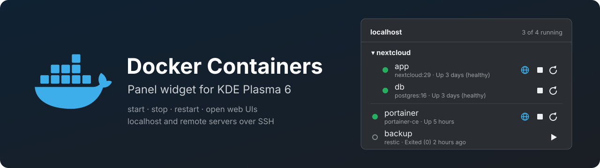

<p align="center">
  
</p>

# Docker Containers for KDE Plasma 6

Panel widget that lists the Docker containers on localhost and on remote servers
(over SSH) and lets you start, stop and restart them.

- Containers grouped by Compose project, with start/stop/restart for the whole project
- Status dot: green = running, yellow = starting/unhealthy/restarting, red = crashed, grey = stopped
- Globe button opens the web UI of a container in the browser
- Expand a container for details, logs, a shell, and removing it

## Install

```bash
./install.sh
```

Then right click the panel → *Add Widgets…* → **Docker Containers**.

## Remote servers

Add one SSH target per line in the widget settings: `user@host`, an IP address or a
`Host` alias from `~/.ssh/config`. localhost is always in the list.

The widget runs `ssh <target> docker …`, so:

- login must work with a key and without a prompt (`ssh <target> docker ps` in a terminal
  must print the container list) – a key with a passphrase has to be loaded in the ssh-agent
- the host key must already be known (connect once by hand)
- the SSH user must be allowed to run `docker` without sudo

Connections are shared through a control socket in `$XDG_RUNTIME_DIR` and kept open for
two minutes, no changes to `~/.ssh/config` are needed.

## Web UI button

The globe button opens, in this order:

1. the URL from the container label `plasma-docker.url`
2. the first `Host(...)` of a Traefik router label
3. the first published TCP port, as `http://<server>:<port>` (`https` for container port 443/8443)

All published ports are available as buttons when the container is expanded.

```yaml
services:
  app:
    labels:
      plasma-docker.url: "https://cloud.example.com"
```

## Settings

| Setting               | Meaning                                                             |
|-----------------------|---------------------------------------------------------------------|
| Remote servers        | SSH targets, one per line                                           |
| Docker command        | `docker` by default; anything with a compatible CLI                 |
| Terminal              | Command that runs its arguments, e.g. `konsole -e`. Empty = system default terminal |
| Refresh while open    | Polling interval while the popup is visible                         |
| Refresh in background | Polling interval for the panel counter, 0 turns it off              |

## Uninstall

```bash
./uninstall.sh
```

## License

GPL-3.0-or-later, see [LICENSE](LICENSE).

This project is not affiliated with or endorsed by Docker, Inc.
